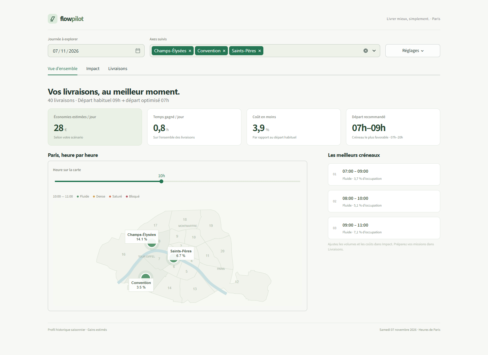

# BCG X Datathon

## Interface client FlowPilot

Une page avec trois onglets : **Vue d'ensemble**, **Impact**, **Livraisons**. Carte de Paris, gains estimes, import des previsions CSV et planning exportable dans un agenda.

**Windows :** double-cliquer sur `Lancer_FlowPilot.bat`, puis ouvrir http://localhost:8501.

**Installation manuelle (Python 3.11+) :**

```bash
python -m venv .venv
# Linux/macOS : source .venv/bin/activate
# Windows : .venv\Scripts\activate
python -m pip install -r requirements.txt
python -m streamlit run app.py
```

[Guide FlowPilot](docs/FLOWPILOT.md) : installation, hypotheses, import CSV et tests. Le profil historique et les gains sont des estimations, en attendant les previsions finales de l'equipe.




## Données

Dans le dossier `data` on peut trouver 3 fichiers différents : `external`, `processed_data` et `unprocessed_data` :

- **`external`** correspond aux données externes ajoutées : météo, calendrier scolaire, évènements historiques majeurs
- **`unprocessed_data`** contient toutes les données du trafic routier de 2014 à 2026. Ces données ne sont pas disponibles sur le git car trop lourdes, mais peuvent être téléchargées [ici](https://opendata.paris.fr/explore/dataset/comptages-routiers-permanents-historique/information/)
- **`processed_data`** contient toutes les données du trafic routier pour les 3 arcs qui nous intéressent

Pour charger facilement les données, vous pouvez vous inspirer du fichier `data_explo.ipynb` en faisant par exemple :

```python
from dataset_create import charger
df = charger()
df.head()
```
